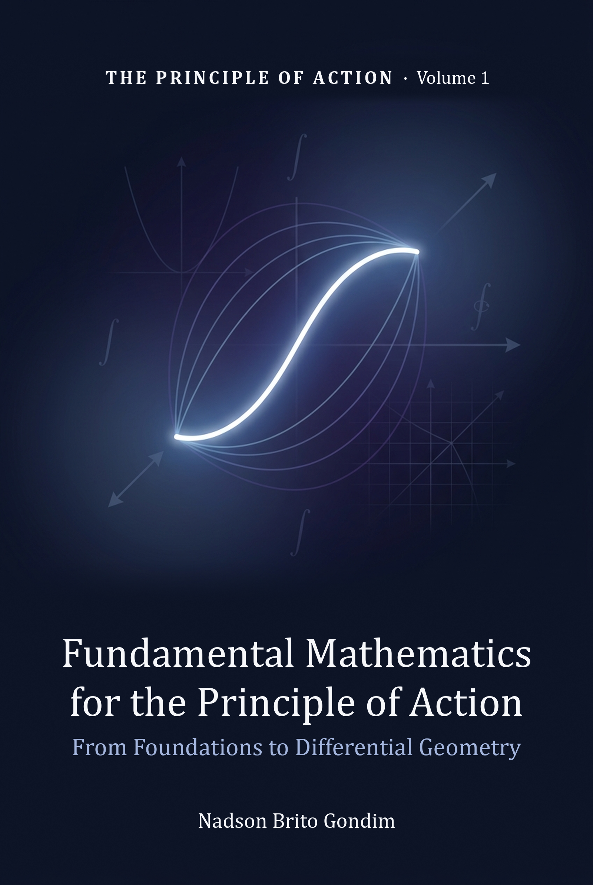
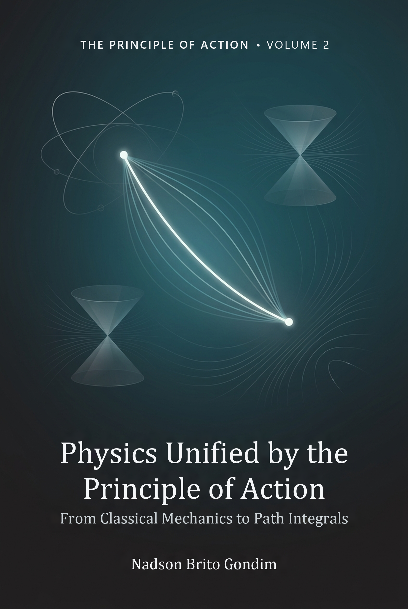
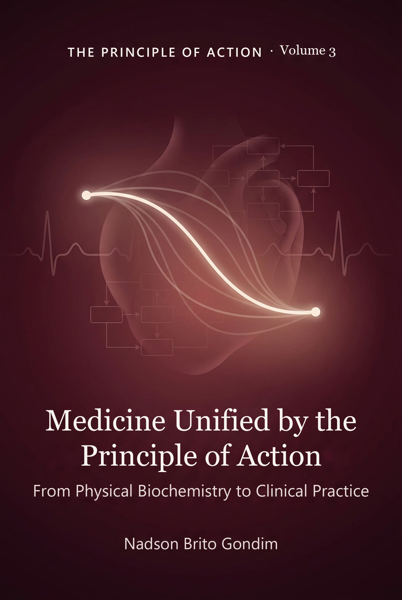
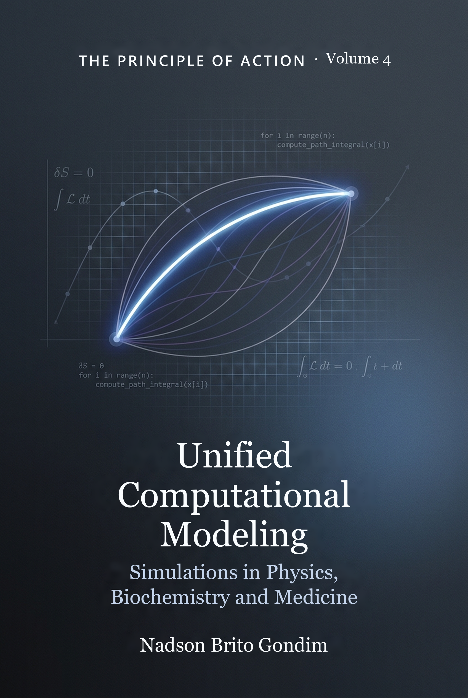

# The Principle of Action — Executable Code

[](LICENSE)
[](https://www.python.org/)
[](#the-series)

> Official repository with **all the executable code** of *Volume 4 — Unified
> Computational Modeling*, from the four-volume series **The Principle of
> Action**, by Dr. Nadson Brito Gondim (UFMA).
>
> Open content under the MIT license: you may read, run, copy, modify
> and redistribute it freely, with or without attribution.
>
> Edição em português / Portuguese edition: https://github.com/nadsongondim/principio-de-acao

> **⚠️ For educational purposes only.** The scripts, modules and
> prototypes in this repository — including the prototype of a physiological
> digital twin — are **teaching material**, not medical devices in the
> regulatory sense (e.g. Software as a Medical Device under the IMDRF
> framework and the corresponding national rules, such as the US FDA, the
> EU MDR or, in Brazil, ANVISA RDC 657/2022). No script is intended for
> diagnosis, treatment, dose adjustment or direct guidance of clinical
> care for an individual patient. For clinical use, models and simulations
> require their own path of validation, regulation and risk management —
> covered in Part VI of Volume 4. Whenever there is any doubt about
> management, individual medical assessment and official sources (health
> authorities, regulatory agencies, medical societies and current
> guidelines) prevail.

---

## The series

The four-volume series **The Principle of Action** starts from a simple and
far-reaching thesis: *the same mathematical structure that governs the motion
of the planets also governs chemical reactions, the firing of neurons and the
growth of a tumor.* Across four volumes, the series builds from this common
thread — the variational principle — a coherent bridge between mathematics,
physics, medicine and computational modeling.

<table>
  <tr>
    <td align="center" width="25%">
      <br>
      <b>Volume 1</b><br>
      <i>Fundamental Mathematics<br>for the Principle of Action</i>
    </td>
    <td align="center" width="25%">
      <br>
      <b>Volume 2</b> ★<br>
      <i>Physics Unified by the<br>Principle of Action</i>
    </td>
    <td align="center" width="25%">
      <br>
      <b>Volume 3</b><br>
      <i>Medicine Unified by the<br>Principle of Action</i>
    </td>
    <td align="center" width="25%">
      <br>
      <b>Volume 4</b><br>
      <i>Unified Computational<br>Modeling</i>
    </td>
  </tr>
</table>

★ *The central volume, which gives the series its name.*

### Volume 1 — Fundamental Mathematics for the Principle of Action

*From Foundations to Differential Geometry.* From the foundations of
elementary mathematics to differential geometry and group theory. It builds
all the mathematical toolkit used in the other volumes: single- and
multivariable calculus, linear algebra, ODEs and PDEs, complex variables, the
equations of mathematical physics, Fourier series, function spaces and
differential geometry.

### Volume 2 — Physics Unified by the Principle of Action ★

*From Classical Mechanics to Path Integrals.* The heart of the series. It
shows how a single mathematical structure — the **principle of stationary
action** — generates the classical mechanics of Lagrange and Hamilton,
electromagnetism, special and general relativity, quantum mechanics via the
path integral, quantum field theory and the Standard Model. It covers the
Higgs mechanism with explicit mathematics, tree-level diagrams, the QCD beta
function and asymptotic freedom, gravitational waves and the quadrupole
formula, and Berry's geometric phases.

### Volume 3 — Medicine Unified by the Principle of Action

*From Physical Biochemistry to Clinical Practice.* It applies variational
principles to medicine: quantitative models for pharmacokinetics,
cardiovascular dynamics, neuroscience, oncology, endocrinology, immunology
and infectious diseases. It establishes an editorial hierarchy — *evidence →
guideline → judgment → model* — to integrate mathematical modeling into
clinical practice without replacing medical reasoning.

### Volume 4 — Unified Computational Modeling

*Simulations in Physics, Biochemistry and Medicine.* It puts everything into
practice in scientific Python code: a reproducible environment, numerical
methods, model validation, simulation of classical mechanics, relativity,
quantum mechanics, molecular structure, enzyme kinetics, PK/PD,
cardiovascular/respiratory and renal/metabolic/endocrine systems,
neuro/immuno/infection, oncology/radiotherapy, DICOM bioimaging, digital
twins, FHIR interoperability and regulatory validation. **This repository
contains all the code of this volume.**

> The four volumes are available in English and in Portuguese, in ebook and
> print editions.

---

## About this repository

This repository accompanies **Volume 4** and was designed so that any
reader — student, teacher, physician, researcher — can:

- **run** every numerical example in the book without copying code from
  the PDF;
- **reproduce** every technical figure of the volume (generated with
  Matplotlib, 100% computational);
- **adapt** the models to their own data, clinical case studies or
  teaching contexts;
- **extend** the models as a starting point for their own projects.

### Structure

```
principle-of-action/
├── README.md              ← you are here
├── LICENSE                ← MIT (free use, copying and modification)
├── CITATION.cff           ← how to cite
├── CHANGELOG.md           ← version history
├── requirements.txt       ← Python dependencies
├── .gitignore
├── docs/
│   └── covers/            ← covers of the 4 volumes
├── figures/
│   └── figures_volume4.py ← generates all 22 technical figures of the book
├── tests/
│   └── test_smoke.py      ← runs every script (smoke test)
└── code/
    ├── ch01_environment_project/
    ├── ch02_numerical_methods/
    ├── ...
    ├── ch22_usability_perspectives/
    ├── appendix_a_installation/
    ├── appendix_b_scientific_python/
    ├── appendix_c_parameters/
    ├── appendix_d_notebooks/
    ├── appendix_e_figures_reports/
    └── appendix_g_answer_keys/
```

Each chapter subdirectory has its own `README.md` explaining what each
`.py` file does.

---

## How to use

### 1. Clone the repository

```bash
git clone https://github.com/nadsongondim/principle-of-action.git
cd principle-of-action
```

Or download the ZIP via **Code → Download ZIP**.

### 2. Create a virtual environment and install the dependencies

```bash
python -m venv .venv
# Linux / macOS
source .venv/bin/activate
# Windows
.venv\Scripts\activate

pip install -r requirements.txt
```

Python **3.10 or later**. The main dependencies are
`numpy`, `scipy`, `matplotlib`, `pandas`, `scikit-learn`, `sympy`,
`pydicom`, `scikit-image`.

Then check the environment (Appendix A):

```bash
python code/appendix_a_installation/check_environment.py
```

The output lists the installed version of each dependency and ends with
`Environment ready.`.

### 3. Run any example

```bash
# Example: harmonic oscillator from Chapter 4
python code/ch04_classical_mechanics/01_harmonic_oscillator.py

# Example: Michaelis-Menten kinetics from Chapter 10
python code/ch10_enzyme_kinetics/01_michaelis_menten_full.py
```

### 4. Reproduce the book's figures

```bash
# Generates all 22 figures of Volume 4
python figures/figures_volume4.py

# Or just one specific figure
python figures/figures_volume4.py fig-04
```

---

## Chapter → directory map

| Ch. | Topic | Directory |
|---:|---|---|
| 1 | Development environment and project organization | `ch01_environment_project/` |
| 2 | Essential numerical methods | `ch02_numerical_methods/` |
| 3 | Modeling, validation and reproducibility | `ch03_modeling_validation/` |
| 4 | Computational classical mechanics | `ch04_classical_mechanics/` |
| 5 | Lagrangian, Hamiltonian and phase space | `ch05_lagrangian_hamiltonian/` |
| 6 | Relativity, fields and electromagnetism | `ch06_relativity_fields/` |
| 7 | Computational quantum mechanics | `ch07_quantum_mechanics/` |
| 8 | Molecular structure and potential energy | `ch08_molecular_structure/` |
| 9 | Reaction pathways, free energy and kinetics | `ch09_reaction_paths/` |
| 10 | Enzyme kinetics and biochemical networks | `ch10_enzyme_kinetics/` |
| 11 | Drug-receptor interaction and molecular pharmacology | `ch11_drug_receptor/` |
| 12 | Computational pharmacokinetics and pharmacodynamics | `ch12_computational_pkpd/` |
| 13 | Cardiovascular and respiratory systems | `ch13_cardiovascular_respiratory/` |
| 14 | Renal, metabolic and endocrine systems | `ch14_renal_metabolic_endocrine/` |
| 15 | Neurophysiology, immunology and infection | `ch15_neuro_immuno_infection/` |
| 16 | Cancer, targeted therapies and radiotherapy | `ch16_cancer_radiotherapy/` |
| 17 | Bioimaging and clinical data | `ch17_bioimages_data/` |
| 18 | Integrated cases in quantitative medicine | `ch18_quantitative_medicine_cases/` |
| 19 | Prototype of a physiological digital twin | `ch19_digital_twin/` |
| 20 | Real-world data, interoperability and security | `ch20_data_interoperability/` |
| 21 | Validation, regulation and clinical responsibility | `ch21_validation_regulation/` |
| 22 | Usability, adoption and perspectives | `ch22_usability_perspectives/` |

| Appendix | Topic | Directory |
|---:|---|---|
| A | Installing and configuring the environment | `appendix_a_installation/` |
| B | Quick guide to scientific Python | `appendix_b_scientific_python/` |
| C | Tables of physical, chemical and physiological parameters | `appendix_c_parameters/` |
| D | Notebooks and project organization | `appendix_d_notebooks/` |
| E | Good practices for figures and reports | `appendix_e_figures_reports/` |
| G | Answer key to the challenge exercises | `appendix_g_answer_keys/` |

A note on names: as in the English edition of the book, **variable,
function and parameter names keep their original Portuguese spelling**
(for example `insulina`, `bergman`, `dose_ataque`), so that the code in this
repository matches the code printed in the book line by line. Comments,
docstrings, printed output and plot labels are in English.

---

## License

[MIT](LICENSE) — free use, copying, modification and redistribution, with or
without attribution. The license of the **code** in this repository is
independent of the copyright of the **text of the books**, which belongs to
the author.

---

## How to cite

If this code is useful to your work, please cite the complete series:

> Gondim, N. B. *The Principle of Action* (four-volume series).
> Author's edition, 2026.

For academic citation in BibTeX or CFF format, see
[`CITATION.cff`](CITATION.cff).

---

## About the author

**Dr. Nadson Brito Gondim** is a physician who graduated from the Federal
University of Maranhão (UFMA), Brazil. *The Principle of Action* is the
fruit of years of reading across mathematics, physics and medicine, with
the ambition of showing that the fragmentation of these fields is only
pedagogical — not ontological.

---

## Contributions and contact

Errors, suggestions and improvements are welcome via *issues* and *pull
requests*. For direct contact, open an *issue* in this repository.

---

<p align="center">
  <i>"Nature is sparing in causes and lavish in effects.<br>
  That is why a single idea can organize so many landscapes."</i>
</p>
